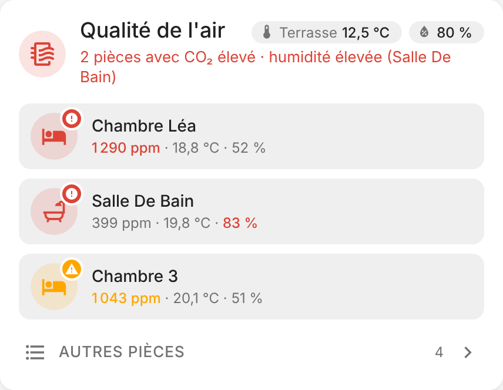
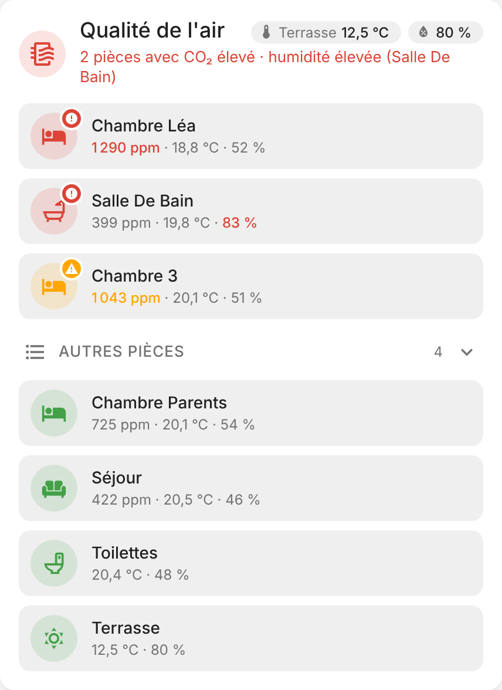
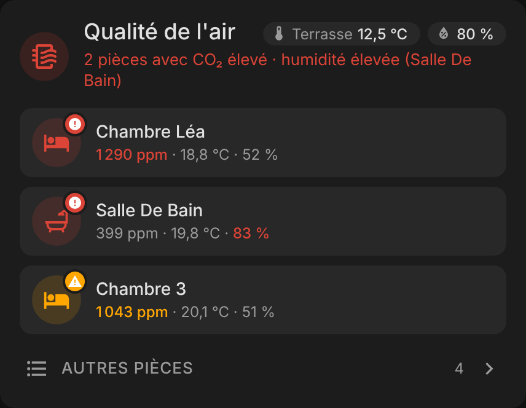
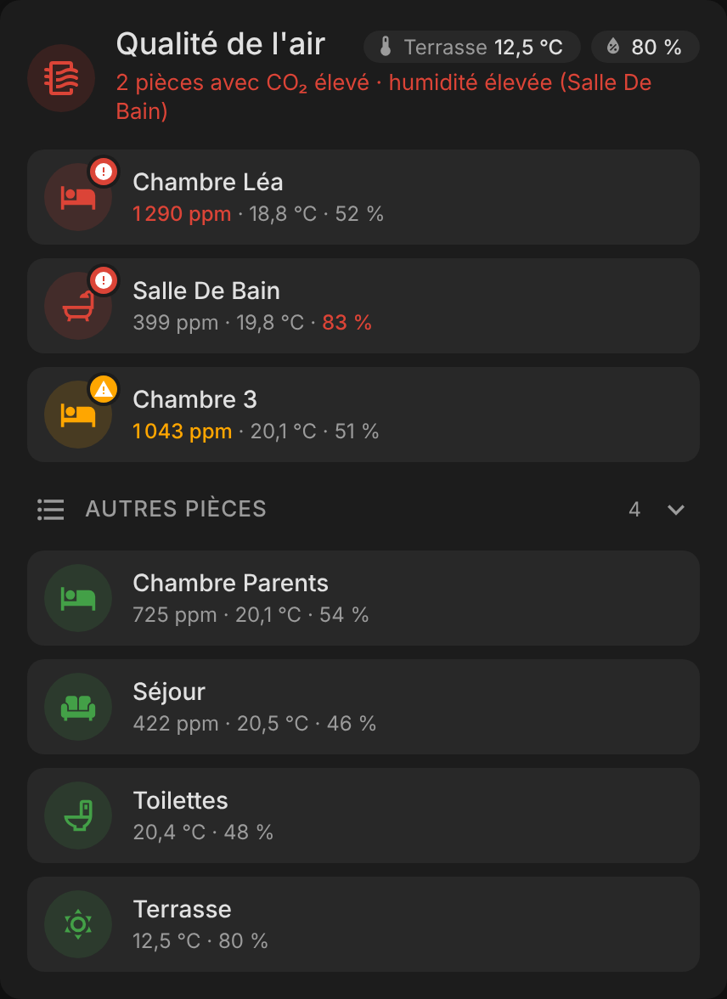

# ha-home-air-quality-card

[](https://github.com/hacs/integration)
[](https://github.com/juju35/ha-home-air-quality-card/actions/workflows/hacs.yml)
[](https://github.com/juju35/ha-home-air-quality-card/actions/workflows/validate.yml)
[](https://github.com/juju35/ha-home-air-quality-card/releases/latest)
[](LICENSE)

Custom Lovelace card for Home Assistant showing the **CO₂, temperature and humidity of every room** in one place: the rooms that need airing first, sorted by level, and the others in a collapsible list.

Add the card, it finds the rooms by itself from your areas.

[](https://my.home-assistant.io/redirect/hacs_repository/?owner=juju35&repository=ha-home-air-quality-card&category=plugin)

| Rooms in alert | Room list open |
|---|---|
|  |  |

## Features

- Header with an icon coloured by the worst room, the outdoor temperature and humidity as badges
- Summary line: *2 rooms with high CO₂ · high humidity (Bathroom)*, or *All good*
- Rooms above a threshold listed first, the worst first: coloured icon (orange above the warning threshold, red above the critical one), alert badge, and the value in alert highlighted
- The icon blinks above the critical threshold (turn it off with `blink: false`; it also stops when the system asks for reduced motion)
- The other rooms in a collapsible list, sorted by CO₂
- Tap a room to open its dashboard (`navigation_path`), or its sensor details
- Automatic room discovery: every area with a CO₂, temperature or humidity sensor becomes a room, with an icon picked from its name (bedroom, living room, bathroom, toilets, kitchen…)
- Outdoor areas (terrace, garden, balcony…) are listed and used for the header badges, but never raise an alert
- Warning and critical thresholds for CO₂ and humidity, for the whole card or per room
- Visual editor in the dashboard UI (no YAML needed)
- English and French, follows the Home Assistant language
- Light and dark theme compatible
- HACS-ready, a single file with no dependency

## Prerequisites

- Home Assistant with CO₂, temperature or humidity sensors (Netatmo, Airthings, Aqara, ESPHome…)
- Areas set on the sensors or their devices, for the automatic discovery; otherwise list the rooms by hand

## Installation

### Via HACS (recommended)

Click the button below to add the repository directly:

[](https://my.home-assistant.io/redirect/hacs_repository/?owner=juju35&repository=ha-home-air-quality-card&category=plugin)

Or manually:

1. Open HACS → **Frontend** → **⋮** → **Custom repositories**
2. Add `https://github.com/juju35/ha-home-air-quality-card` — Category: **Dashboard** (Lovelace)
3. Search for **Home Air Quality Card** and install it
4. Clear your browser cache and refresh

HACS registers the dashboard resource for you.

### Manual

1. Download `home-air-quality-card.js` from the [latest release](https://github.com/juju35/ha-home-air-quality-card/releases/latest)
2. Copy it to `/config/www/`
3. Go to **Settings → Dashboards → Resources** → Add resource:
   - URL: `/local/home-air-quality-card.js`
   - Type: **JavaScript Module**
4. Clear your browser cache and refresh

## Configuration

### Visual editor

Add the card from the dashboard (**Add card → Home Air Quality Card**). With no room listed, it shows every area that has a sensor. Add rooms in the **Rooms** list to choose them, their order, icon and navigation path. Options left at their default are not written to the YAML.

### Minimal

```yaml
type: custom:home-air-quality-card
```

### Full options

```yaml
type: custom:home-air-quality-card
title: Air quality
icon: mdi:air-filter
outdoor_temperature: sensor.outdoor_temperature
outdoor_humidity: sensor.outdoor_humidity
outdoor_name: Terrace
co2_warning: 1000
co2_critical: 1200
humidity_warning: 70
humidity_critical: 80
expanded: false
sort: co2
rooms:
  - area: bedroom_lea
    navigation_path: /dashboard-home/bedroom-lea
  - name: Living room
    icon: mdi:sofa
    co2: sensor.living_room_co2
    temperature: sensor.living_room_temperature
    humidity: sensor.living_room_humidity
    navigation_path: /dashboard-home/living-room
  - area: bathroom
    co2_warning: 1500
    navigation_path: /dashboard-home/bathroom
  - area: terrace
    alerts: false
```

A room with an `area` takes the sensors of that area (the CO₂ sensor first, then the temperature and humidity sensors of the same device when there are several); `co2`, `temperature` and `humidity` replace them one by one.

### Options reference

| Option | Required | Default | Description |
|---|---|---|---|
| `title` | ❌ | `Air quality` | Card title |
| `icon` | ❌ | `mdi:air-filter` | Icon next to the title |
| `outdoor_temperature` | ❌ | Auto | Outdoor temperature badge; taken from an outdoor area when both outdoor sensors are empty |
| `outdoor_humidity` | ❌ | Auto | Outdoor humidity badge |
| `outdoor_name` | ❌ | Area name | Name shown on the temperature badge |
| `co2_warning` | ❌ | `1000` | CO₂ (ppm) above which a room is in alert (orange) |
| `co2_critical` | ❌ | `1200` | CO₂ (ppm) above which a room is critical (red, blinking) |
| `humidity_warning` | ❌ | `70` | Humidity (%) above which a room is in alert |
| `humidity_critical` | ❌ | `80` | Humidity (%) above which a room is critical |
| `show_summary` | ❌ | `true` | Summary line under the title |
| `show_all_rooms` | ❌ | `true` | Collapsible list of the rooms not in alert |
| `expanded` | ❌ | `false` | Open the room list when the dashboard loads |
| `blink` | ❌ | `true` | Blink the icon of critical rooms |
| `sort` | ❌ | `co2` | `co2` (highest first), `name`, or `none` (configuration order); rooms in alert always come first by level |
| `rooms` | ❌ | Auto | List of rooms, see below; every area with a sensor when empty |
| `exclude_areas` | ❌ | — | Areas left out of the automatic discovery |
| `language` | ❌ | Auto | Force language: `fr` or `en` (auto-detects from HA settings) |

**Room options**

| Option | Description |
|---|---|
| `area` | Area of the room: name, icon and sensors come from it |
| `name` | Room name; defaults to the area name |
| `icon` | Room icon; defaults to the area icon, or one picked from the name |
| `co2` / `temperature` / `humidity` | Sensors, replacing the ones found in the area |
| `navigation_path` | Dashboard opened on tap, e.g. `/dashboard-home/bedroom`; without it the tap opens the sensor details |
| `alerts` | `false` to never put the room in alert (outdoor areas are `false` by default) |
| `co2_warning`, `co2_critical`, `humidity_warning`, `humidity_critical` | Thresholds for this room only |

## Screenshots

| Rooms in alert | Room list open |
|---|---|
|  |  |
|  |  |

## How it works

A room is **in alert** when its CO₂ or humidity is above the warning threshold, **critical** above the critical threshold. Rooms in alert are listed first, critical ones before the others, then by CO₂. The summary counts the rooms with high CO₂ and names the rooms with high humidity.

The automatic discovery goes through the areas, and keeps every area with a sensor whose device class is `carbon_dioxide`, `temperature` or `humidity` (set on the entity or on its device). Areas whose name looks outdoor (terrace, garden, balcony, outdoor…, in English and French) never raise an alert, and the first one fills the header badges when `outdoor_temperature` and `outdoor_humidity` are empty.

## Development

```bash
npm install
npm run build        # stamps the version of package.json into dist/home-air-quality-card.js
npm run check        # builds and checks the card (run in CI)
npm run screenshots  # renders the card with mock rooms into screenshots/
```

`dist/` is not committed: `npm run build` creates it locally, CI builds it on every push, and the release workflow attaches the built file to the release, which is where HACS downloads it from.

### Releasing

1. Bump `version` in `package.json`
2. Add a `## <version>` section at the top of [CHANGELOG.md](CHANGELOG.md)
3. Push to `main`: the **Release** workflow builds the card, creates the tag and the GitHub release with the changelog section as notes, and attaches `home-air-quality-card.js`

## Translations

The card auto-detects the language from your Home Assistant settings. Currently supported:

| Language | Code |
|---|---|
| English | `en` |
| Français | `fr` |

Contributions for additional languages are welcome!

## License

[MIT](LICENSE)
